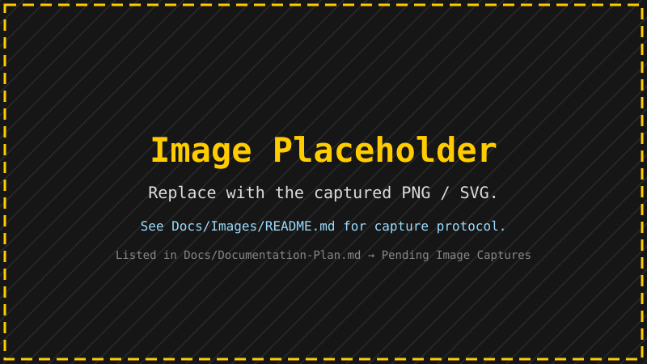

# Capture Guide

Screenshots, posters, QR codes, videos, and PNG sequences from Fracturing Fog.

> Companion pages: [User Index](_Index.md) · [Avalonia User Guide](Avalonia-UserGuide.md) · [Regions Guide](Regions-Guide.md)



---

## A friendly tour

There are four ways to save a picture out of Fracturing Fog. Pick the one that matches what you
want to *do* with it, and the rest follows:

| You want to…                                  | Use this button     | Format you get          |
|------------------------------------------------|---------------------|-------------------------|
| Post a screenshot to social media              | **Image**           | One PNG, ~1-3 MB        |
| Print a wall-sized poster, or send to a printer | **Poster**         | One huge TIFF/PNG       |
| Make a QR code that is also a fractal           | **Export QR Image…** (Capture → QR Code) | One square PNG / JPEG / WebP |
| Record whatever is on screen right now         | **● Rec** / **F9**  | MP4 / H.265 / WebM / MKV / GIF / PNG — picked when you stop |
| Share a smooth zoom-in video                   | **Video** (tick *Record this run*) | Same choice as ● Rec |
| Loop endlessly between favourite views         | **Video Slideshow** (tick *Record this run*) | Same choice as ● Rec |

> [!TIP]
> Before you capture, decide what should be in the picture. Should the **grid** be on? Should the
> **watermark** be on? Should the **post-FX** sliders (brightness / contrast / adaptive) be applied?
> All three flow into the saved file exactly as you see them on screen.

### Worked example — "I just want a 4K screenshot of Seahorse Valley"

1. From the **Region** combo (toolbar), pick **Seahorse Valley**. The view jumps to the saved spot.
2. Optional: switch the **Theme** combo to *Fire* for a warmer look.
3. Optional: hide the **Grid** (toolbar toggle) so the image is clean.
4. Press **`M`** to open the Floating Menu, then click **Image**.
5. Pick a filename ending in `.png`, hit Save. You get a 1920×1080 PNG by default; if your window
   is bigger, you get the window's resolution.

> [!NOTE]
> For a true 3840×2160 (4K) capture independent of your monitor, use **Poster** instead and dial
> in `Width=3840`, `Height=2160`, `Tile=1024`. The Poster path runs the calculator afresh per tile
> at full quality — what you save is exactly what the math produced, not what the screen sampled.

### Worked example — "I want a 30-second zoom-in video into a deep region"

1. Pan, zoom, or apply a region until you are on the *starting* frame you want to see.
2. Switch on **Lock Iterations** in the Region Navigation panel if you have already tuned the iter
   count for the deep target. Otherwise the video may starve detail on the inner frames.
3. Open Floating Menu → **Video**.
4. Pick **Region = Mini Mandelbrot** (or whatever deep spot you want to dive into).
5. Duration `30` seconds, start zoom `0.5`, and tick **● Record this run**.
6. Click **Start**. When the zoom ends the **Save Recording** prompt asks for the format (MP4 for a
   quick share, *MKV — FFV1* for archival), quality, frame rate and size.

> [!WARNING]
> H.265, WebM and lossless MKV need `ffmpeg.exe` (install it from **FFmpeg Setup**). The app looks
> for it in the install folder, then `Tools\`, then your `PATH`. Without it the prompt offers MP4,
> animated GIF and PNG sequence only.

> [!NOTE]
> **Audio in exports (#435).** When Audio settings are **Enabled** with **Source = File**, the
> chosen audio file is muxed into the exported video after encoding — Video Zoom, the image
> Slideshow's *Convert*, and the lossless *encode* paths all attach it (AAC, trimmed to the shorter
> of video/audio). Because the audio-reactive analysis and the mux both start from the file at
> `t = 0` at a constant frame rate, the result is frame-accurate. Streamed sources (System Loopback /
> Microphone) are not muxed yet — capturing a live stream to a file for later render is tracked
> separately (#773). The status line shows "(with audio)" when a track was attached; a mux failure
> is non-fatal and keeps the silent video.

---

## Table of Contents

1. [Screenshot (Image button)](#1-screenshot-image-button)
2. [Poster (multi-tile)](#2-poster-multi-tile)
   - 2a. [QR Code (a fractal that scans)](#2a-qr-code-a-fractal-that-scans)
3. [Video Zoom (single shot)](#3-video-zoom-single-shot)
4. [Video Slideshow (continuous loop)](#4-video-slideshow-continuous-loop)
5. [Recording Formats](#5-recording-formats)
6. [ffmpeg Discovery + Flags](#6-ffmpeg-discovery--flags)
7. [Resolution Reference](#7-resolution-reference)
8. [Batch CLI](#8-batch-cli)
9. [Watermark](#9-watermark)
10. [Tips](#10-tips)

---

## 1. Screenshot (Image button)

The Image button in the Control Center's Capture section saves the current view as a single still.

| Behavior | Description |
|---|---|
| Format | PNG (default), JPEG, BMP, TIFF, **GIF**, **ICO**, **EXR** — chosen by file extension |
| Resolution | Current panel resolution, OR full virtual desktop when Span is active |
| Post-FX | Live brightness / contrast / adaptive applied |
| Watermark | Embedded if the Watermark toggle is on. Contrast-aware text color. |
| Filename | Auto-generated: `FracturingFog_Theme_Region_x...y...z...i..._WxH.png` |

The file dialog defaults to your Pictures folder; switch to any path before confirming.

> [!NOTE]
> **Name the file `.exr`** to save an OpenEXR instead of a PNG. EXR is a
> floating-point, scene-linear format that Blender, Nuke, DaVinci Resolve and
> `oiiotool` read — the right choice when you plan to grade or composite the
> render, not just view it. The RGB is un-gamma'd to linear on the way out and
> alpha is preserved. (Watermarks are skipped on EXR — they are a display-space
> overlay.) Today the source is the same 8-bit render promoted to float;
> true high-dynamic-range AOV layers land with the render-pass work (roadmap S1).

> [!NOTE]
> **Name the file `.ico`** to save a Windows icon. The frame is center-cropped
> to a square and written as a multi-resolution set (16 / 32 / 48 / 256,
> capped to the cropped side) so the OS can pick the size it needs — handy for
> turning a favourite view into an app or shortcut icon. Watermarks are skipped
> (an icon-sized overlay is meaningless).

> [!NOTE]
> **Name the file `.gif`** to save a GIF. The frame is quantized to a 256-colour
> palette (median cut) with 1-bit transparency, so smooth fractal gradients will
> band — PNG stays the better choice for stills. GIF is handy for small,
> few-colour images and for pasting where only GIF is accepted. This is a single
> still; for an **animated** GIF record with **● Rec** / **F9** and pick *Animated GIF*
> in the Save Recording prompt ([§3](#3-video-zoom-single-shot)).

---

## 2. Poster (multi-tile)

The Poster button renders a tiled composite at print resolution. Each tile is calculated separately at full quality; tiles stitch into one large image.

### Dialog options

| Field | Range | Default |
|---|---|---|
| Width × Height | up to 32768 × 32768 | 7680 × 4320 (8K) |
| Tile size | 256 – 4096 | 1024 |
| Format | .png / .tif / .tiff / .bmp | .png |
| Output | file path or folder | (current dir) |
| Apply post-FX | on / off | on |
| Include watermark | on / off | on |

### Workflow

1. Pan + zoom to your subject.
2. Open Poster.
3. Set output dimensions (e.g., 11520 × 8640 = 12K, 15360 × 8640 = 16K wide).
4. Pick a tile size — 1024 is the default; smaller tiles parallelise better but increase seam risk; larger tiles use more memory.
5. Browse to output path.
6. Click Render. Progress bar shows tile-of-total + ETA.

Cancel any time — the partial frame buffer is dropped.

### Soft cap

A 64-megapixel ceiling applies by default to protect against accidental OOM (a 32k × 32k render holds ~10 GB resident). Override only if you have the RAM headroom.

### Remote poster

Use the Client dialog instead of the local Poster button:

1. Pick a saved server connection.
2. Mode = `image`.
3. Width × Height = your poster dimensions.
4. Pick fractal / region / theme / quality.
5. Output: a local file path on YOUR machine.

For huge posters, set Return mode = `saved-path`. The server keeps the file on its disk and replies with the path; read it later over file share. Inline (default) streams bytes in 1 MB chunks over TLS — fine for a few-MB poster, slow for multi-GB.

---

## 2a. QR Code (a fractal that scans)

**Control Center → Capture → QR Code** saves the current view as a square image that is
also a working QR code. Point a phone camera at it and it opens your link; look at it and
you see the fractal. Introduced by epic #1305.

1. Pan / zoom / theme the view as usual.
2. Type the **Text** the code should carry, usually a URL. Shorter text makes a smaller
   code with bigger modules, so more of the fractal survives.
3. Optional: **Find View** to nudge the framing toward one the code fits better, and/or
   tick **Shape to the image** (see below).
4. Click **Export QR Image…** and pick a file. PNG is best; JPEG and WebP work.
5. The status line reports whether the **saved file** scans, e.g.
   *Saved … — scans (4/4 passes) (version 6, 24 px/module)*. A failure shows in yellow
   with what to change.

The default file name ends in `_qrc`, the way posters end in `_poster` and wallpapers in
`_wallpaper`: `FracturingFog_…_1200x1200_qrc.png`.

### Controls

| Control | What it does | Default |
|---|---|---|
| Text | The payload (UTF-8). Up to 2953 bytes, but a short URL looks far better. | — |
| Style | **Steer**: every module is recoloured into a dark or light band (hue kept). **Dots**: only a square at each module's centre is forced; the fractal shows around it. **Halftone**: each module split 3×3; the centre cell carries the code, the outer cells are the fractal's own halftone. **Bevel (3D)**: dark modules become raised blocks lit by the 3D theme ([below](#bevel-3d)). | Steer |
| Error fix | Reed-Solomon level, the share of the code that can be damaged and still scan: L 7%, M 15%, Q 25%, H 30%. Higher tolerates more but makes the code larger. | H |
| Size | Side of the square image in pixels. | 1200 |
| Module px | Pixels per module. 0 = the largest that fits with the 4-module quiet zone. | 0 |
| Dot | Size of the forced centre square, as a fraction of the module (Dots style; Steer's strict core). | 0.40 |
| Invert | Light modules on a dark field. Many readers accept it, but not all. | off |
| Version | Smallest QR version (1–40). Above what the text needs it makes a bigger code with smaller modules, and frees bits for *Shape to the image*. | 1 |
| Shape to the image | QArt: choose the data bits a reader never reads so the code's own pattern follows the fractal (#1402). | off |
| Find View | Search around the view for a framing that needs fewer changes (#1401). | — |

### How it stays scannable

A reader turns the picture into black and white and samples the middle of each module.
The QR code only ever changes **lightness**: hues and colours stay the fractal's own. The
three corner squares, the timing lines and the format bits are always drawn at full
strength, and the 4-module border is lifted into the light band.

After the file is written it is **decoded again** by an independent reader, four ways:
full size, shrunk to 3 pixels per module, blurred, and re-saved as a JPEG at quality 70.
It counts as scanning only when all four return the exact text. The check reads the file
on disk, so the watermark and the encoder are included. The mask pattern is chosen the
same way: patterns are tried until one composite passes every check, because a reader can
mistake a fractal shape for one of the corner squares.

### Bevel (3D)

The **Bevel (3D)** style (#1409) turns the dark modules into raised blocks on a light
floor. Neighbouring dark modules merge into one block, so the corner squares read as
solid rings. The block edges are sloped and lit, and each block casts a soft shadow
onto the floor.

The light comes from the active **3D theme** (its key, fill and rim lights, Phong or
PBR), so the code is lit the same way as the fractal. A theme without 3D lights gets
one light from the upper left. Untick **Light from the 3D theme** to set the direction
yourself.

| Control | What it does | Default |
|---|---|---|
| Height | Block height as a fraction of the module. Taller blocks cast longer shadows and their edges shade harder. | 0.35 |
| Bevel | Width of the sloped edge as a fraction of the module. | 0.20 |
| Shine | Specular highlight on the lit edges. | 0.50 |
| Shadow | How dark the cast shadow is. | 0.40 |
| Azimuth / Elevation | Light direction when not taken from the theme: degrees counter-clockwise from the right (90 top, 135 upper left), and height above the image (1–89). | 135 / 30 |

The middle of every module stays in its dark or light band whatever the lighting.
Shading and shadows fade out toward the middle, and a module that a long shadow
covers is lifted back as a whole, so the code scans like **Steer**. The saved file is
still decoded afterwards.

### Extrude in Relief 3D

With the view in **Relief 3D** raymarch mode (Color & Light → Relief 3D, oblique 3D on),
tick **Extrude in Relief 3D** (#1410) to build the code into the 3D scene itself. The dark
modules become raised blocks on a plinth. Then the relief camera's tilt, cast shadows,
ambient occlusion, the scene lights, HDRI and glass all act on the code. Without Relief 3D
raymarch, the flat style is exported as usual.

| Control | What it does | Default |
|---|---|---|
| Blocks | Block height in modules. | 0.50 |
| Terrain | How much of the fractal's own relief stays under the code: 0 = a flat plinth, 1 = the full terrain. Tall terrain casts shadows across modules and can hide them. | 0.15 |
| Min elev. | Lowest camera elevation while the code is extruded. A lower Relief 3D camera is raised to it, because a low camera lets a block hide the module behind it. | 60 |

The camera also **zooms out** automatically if the code's border would leave the frame
(a tilted camera pushes the near edge out). After the render, every pixel is traced back to
the module it shows, and its lightness is held in that module's band, so shading and
shadows survive at the module edges while the middles stay readable. The saved file is
still decoded afterwards.

In testing, codes scanned at 50° and above and failed at 40°. The 60° minimum keeps a
margin. Set **Module px** to make the code smaller than the image if you want the fractal
terrain to show around it.

### 3D-printable tile (Export QR Mesh…)

**Export QR Mesh…** (#1411) saves the code as a tile you can 3D print: a base plate with
the dark modules standing up from it, sized in millimetres. The code and colours come from
the current view, framed the same way as **Export QR Image…**.

| Control | What it does | Default |
|---|---|---|
| Tile mm | Side of the tile, the code plus its quiet zone. | 60 |
| Base mm | Thickness of the base plate. | 2 |
| Raise mm | How far the dark modules stand above the base. | 1 |
| Terrain mm | Relief from the fractal's brightness under the code. 0 = a flat plate. | 0 |

Pick the format in the save dialog:

| Format | Carries | Use it for |
|---|---|---|
| **STL** | geometry only, Z up, mm | a single-colour or two-material (filament swap) print |
| **3MF** | geometry + per-vertex colour, mm | colour printers and slicers that read 3MF colour |
| **OBJ** | geometry + vertex colour, Y up | Blender and other 3D tools |

Every tile is checked before the status line reports it. The mesh must be **watertight**
(closed, 2-manifold and wound outward), and a straight-down view of the mesh must
**decode** to your text. For an STL the view is shaded by height, as a two-material print
looks; for 3MF and OBJ it uses the colours. Where two raised modules touch only at a
corner, one sixteenth of a module is filled in to join them. A corner-only contact is
not printable as a solid, and the fill does not affect scanning.

**Two-material print recipe (STL, Terrain 0):**

1. Slice the STL as is; it lies flat, already in millimetres.
2. Print the base in a light filament.
3. Add a filament change (pause / M600) at the layer **Base mm** (2 mm by default), so
   the raised modules print in a dark filament.
4. Scan it. A matte dark filament on a white base reads best. Leave the 4-module light
   border uncovered.

With **Terrain** above 0 the modules no longer start at one height, so a filament swap
cannot separate them. Use 3MF or OBJ colour instead; the STL height check then reports
that it does not scan. A real print test is manual; please note results on #1411.

### Find View

Looks around the current view (position and zoom, within 0.5×–8× of the start zoom) and
over the 8 mask patterns. It picks the framing where the code changes the picture least,
then goes there; Backspace returns. The status line reports the result, e.g.
*luma change 36% → 33%*. A framing must keep at least 80% of the start view's detail;
otherwise the search would drift to a flat, featureless area (cheap to recolour, but no
fractal left). Gains are modest by nature, because QR data looks random and no picture
lines up with it well.

### Shape to the image

A reader stops at the end of the text, so the code's remaining data bits are free. With
this ticked they are chosen so the code's own modules match the fractal's light and dark
areas, strongest contrast first. The result is still a perfect, error-free code; it just
already looks like the picture, so the style barely has to change it.

How much follows the image depends on how many bits are free:

| Settings (40-character URL) | Free bits | Code matches the image |
|---|---|---|
| Error fix L, Version 1 (code is v3) | 40 | 53% → 57% |
| Error fix H, Version 1 (code is v6) | 80 | 51% → 53% |
| **Error fix L, Version 8** | 1152 | **51% → 84%** |

So for a strongly shaped code, pick **Error fix L** and raise **Version** to 6–10. Since
the code is error-free, it doesn't need the high error correction that unshaped codes rely on.

> [!TIP]
> **Steer** is the most robust style; **Dots** and **Halftone** show more fractal but give
> the reader less to work with. If a style fails the check, try Steer, a higher Error
> fix, a shorter text or a larger Size. The export never hides a failure.

> [!NOTE]
> The code is centred in a square image and always dark-on-light unless **Invert** is
> ticked. The same settings go into **Command → Seed from live view** as the `--qr-*`
> flags ([§8](#fractal-qr-code-1305)), so a QR export can be reproduced headless.

---

## 3. Video Zoom (single shot)

The Video button animates a smooth zoom from the current view to the active region's coordinates.

### Motion

| Phase | Duration | Behavior |
|---|---|---|
| Pan | First 5 % | Pan to target center at current zoom |
| Zoom | Last 95 % | Log-zoom interpolation, center fixed |

Both phases smoothstep-eased.

#### Motion type and 3D orbit (#954)

The dialog's **Motion** list picks how the video moves. **Auto** follows the
fractal family, the same rules batch video and the video slideshow use:

| Family | Auto motion |
|---|---|
| 2D escape-time (Mandelbrot, Julia, Newton, …) | The pan + zoom above |
| Raymarched 3D (Mandelbulb, Mandelbox, KIFS, Quaternion, …) | Camera fly-in from 6× wider to the target framing (centre pinned) |
| Logistic, Acid Warp | Render the target, then sweep (Logistic scrolls its r-window, Acid Warp morphs its flow) |
| Other non-spatial (Flame, Plasma, DLA, Buddhabrot, IFS, …) | Render the target once, then a slow Ken-Burns pan + zoom |

Choose **Zoom**, **Hold**, **Ken-Burns** or **Sweep** to force a motion; a choice
that doesn't fit the family is adapted (e.g. Sweep on Julia becomes Ken-Burns) and
the status line says so. **3D orbit (°)** swings a raymarched camera around the
object over the video — on top of the fly-in, or on a Hold. Both settings stay
for the session and also apply to the **Slideshow** button (every leg).

### Frame rate

**Calculation-bound, not wall-clock-bound.** The loop advances by elapsed wall-clock time so the total duration is honored even if individual frames take longer than 1/fps to render. Drop quality + iter cap if you need consistent fps.

### Live TAA tuning

While a video zoom is rendering, three extra sliders appear in the Floating Menu:

| Slider | Range | Purpose |
|---|---|---|
| TAA Alpha | 0 – 1 | Temporal blend strength between successive frames |
| Fade Start | 1e0 – 1e60 zoom | Where the deep-zoom artifact fade begins |
| Fade End | 1e0 – 1e60 zoom | Where the fade reaches full strength |

Use TAA Alpha around 0.3 – 0.6 for cinematic smoothing without ghost trails.

### Per-region iter override

Regions may carry a stored iteration target. During the video leg, MaxIterations is raised to at least that value so the deep target doesn't render as all-in-set black just because the quality preset's iter formula produced a smaller number.

### Start point

By default a forward zoom begins at the classic full view. The **Start from**
picker changes where it begins:

| Choice | Zoom begins at |
|---|---|
| Classic full view (default) | The whole-set overview, as before |
| Current view | Wherever you are right now (centre + zoom) |
| *(a saved region)* | That region's coordinates + zoom |

A start **region** must be the **same fractal type** as the target (its X/Y are
meaningless otherwise) — a mismatch falls back to the classic view with a status
note. The picker is ignored for a **reverse** zoom (which already starts at the
target).

> [!NOTE]
> When the start and target are both **deep** and **far apart** on the plane, a
> straight pan would fly sideways at high zoom. The zoom automatically inserts a
> **dolly** — zoom out to a level where both fit, pan across, then zoom back in —
> so the motion stays watchable. Near or shallow starts pan directly, unchanged.

### Recording outputs

All interactive recording goes through one recorder and one **Save Recording**
prompt (#936):

- **Instant record** — press **F9**, click the toolbar **● Rec** button, or pick
  **Record** from the render-window right-click menu. Everything the render
  window shows is captured as displayed: themes and theme fades, animations,
  slideshow legs, lighting / FX, watermark, HUD. Press again to stop.
- **Record this run** — tick it in the Video Zoom dialog and the zoom (or the
  video slideshow) is recorded from start to finish; the recording stops by
  itself when the run ends.

When recording stops, the **Save Recording** prompt offers:

| Choice | Options |
|---|---|
| Format | MP4 — H.264 · MP4 — H.265 · WebM — VP9 · MKV — FFV1 (lossless) · Animated GIF · PNG sequence |
| Quality | Lossless · High · Medium · Low (ignored by MKV / PNG) |
| Frame rate | 15 – 60 fps (resampled from the capture) |
| Size | 100 / 75 / 50 / 25 % |

**Discard** asks before throwing a take away, and a failed export re-opens the
prompt so you can try another format.

### Quick Record settings

**Control Center ▸ Capture ▸ Quick Record** holds the recorder's defaults:
capture rate, default format / quality / frame rate / size, and **Ask how to
save when recording stops**. Turn that off to skip the prompt entirely:
recordings then save straight to the chosen folder (default
`Videos\FracturingFog`) with the defaults. The prompt remembers your last
choices here.

> [!NOTE]
> The recorder samples the window at the capture rate, but only saves a new
> frame when the picture actually changed — a still view costs almost nothing,
> and playback follows real time. The low-resolution previews shown *while*
> dragging are not recorded, only the settled frames. **Animated GIF** and MP4
> work without ffmpeg (built-in encoders); H.265 / WebM / MKV need it.

---

## 4. Video Slideshow (continuous loop)

A continuous mode: zoom in → pause → zoom out → next region → repeat.

| Leg | Default | Configurable |
|---|---:|---|
| Zoom in duration | 30 s | Slideshow Settings |
| Pause at target | 7 s | Slideshow Settings |
| Zoom out duration | 30 s | Slideshow Settings |
| Inter-region gap | 0 s | Slideshow Settings |

Stops independently from the single-shot Video feature. Esc or the Slideshow button toggles off.

Each leg moves the way its region's family moves (2D zoom, 3D camera fly-in,
non-spatial hold — with the *Ken-Burns* / *Animate hold legs* toggles). A video
preset's **Motion** list overrides that for every leg (Hold / Ken-Burns / Sweep,
adapted per family; Auto keeps the per-family routing), and **3D orbit °** swings
the camera on 3D legs (#954). Both are saved with the preset.

The Video button label flips to **Stop** while running.

### 4a. Record an Image Slideshow to Video

The image slideshow (Slideshow Settings → Type = Image) can now be captured.
Tick **Record Slideshow** in the Slideshow Settings dialog and pick an encode
preset. The engine streams every cross-fade interpolation frame into a PNG
sequence under your temp folder while the slideshow runs.

When you Stop the slideshow you get a three-button prompt:

| Button | Action |
|---|---|
| **Convert** | Runs ffmpeg with the chosen preset and saves a video file. Temp PNG folder is deleted on success. |
| **Save Frames** | Pick a destination folder; the PNG sequence is moved there for offline post-processing. |
| **Cancel** | Discards the temp PNG folder. |

Encode presets:

| Preset | Codec / container | Notes |
|---|---|---|
| HighQualityH264Mp4 (default) | libx264 -crf 18, yuv420p | Visually lossless, small, broad-compat |
| LosslessH264Mp4 | libx264 -qp 0, yuv444p | Mathematically lossless |
| Ffv1Mkv | FFV1 v3 in Matroska | Archival / editing pipeline |

The Convert path needs `ffmpeg.exe` — install it via the floating menu's
**FFmpeg Setup** dialog first. Save Frames works without ffmpeg.

---

## 5. Recording Formats

Interactive recordings pick their format in the Save Recording prompt (§3).
The table below covers the **batch** (`--batch --mode video`) and image-slideshow
*Convert* encode presets.

| Format | Container | Encoder | Needs ffmpeg? | Best for |
|---|---|---|---|---|
| None | — | — | No | Live playback only |
| MP4 (built-in) | .mp4 | Media Foundation H.264 | No | Quick exports, browser playback |
| Lossless H.264 | .mp4 | libx264 -qp 0, yuv444p, +faststart | Yes | Mathematical-lossless archive |
| Lossless FFV1 | .mkv | FFV1 v3 in Matroska | Yes | Archival / editing pipeline |
| H.264 HQ | .mp4 | libx264 -crf 18, yuv420p | Yes | Visually-lossless sharing |
| PNG sequence | folder | (sidecar) | No | Offline encoder pipelines |

### File-size order of magnitude

For a 60s 1080p 30fps clip:

| Format | Approximate size |
|---|---:|
| MP4 (built-in) | 30 – 80 MB |
| H.264 HQ | 80 – 200 MB |
| Lossless H.264 | 1 – 4 GB |
| Lossless FFV1 | 800 MB – 2.5 GB |
| PNG sequence | 5 – 15 GB |

A 4K 60s 60fps clip is ~16× a 1080p 30fps clip.

---

## 6. ffmpeg Discovery + Flags

ffmpeg.exe discovery order:

1. The app folder.
2. `<install>\Tools\`, `<install>\Resources\`.
3. PATH.

Missing ffmpeg with a lossless preset selected: exit code 3 (batch) or a clear error toast (UI).

### Workflow when ffmpeg is engaged

1. Render every frame to disk as `frame_NNNNNN.png` (image2 demuxer compatible — starts at 000001).
2. Invoke ffmpeg on the sequence with the preset's argument set. ffmpeg progress feeds a second progress meter.

### Preset arguments

Lossless H.264 (`h264`):

```
-i frame_%06d.png -c:v libx264 -qp 0 -preset veryslow -pix_fmt yuv444p
-movflags +faststart out.mp4
```

Lossless FFV1 (`ffv1`):

```
-i frame_%06d.png -c:v ffv1 -level 3 -coder 1 -context 1 -g 1 -slices 24
-slicecrc 1 -pix_fmt yuv422p out.mkv
```

H.264 HQ (`h264hq`):

```
-i frame_%06d.png -c:v libx264 -crf 18 -preset slow -pix_fmt yuv420p
-movflags +faststart out.mp4
```

### Keep / discard PNG sidecar

By default `--keep-frames` is on with `none` and off with lossless presets (since frames are intermediates). Override:

```
FracturingFog.exe --batch --mode video … --lossless ffv1 --keep-frames
FracturingFog.exe --batch --mode video … --lossless none  --no-keep-frames
```

In the UI, Slideshow Settings → Video tab has a `Keep frames` checkbox.

---

## 7. Resolution Reference

| Target | Pixels | Aspect | Notes |
|---|---:|---|---|
| 720p | 1280 × 720 | 16:9 | YouTube minimum |
| 1080p (FHD) | 1920 × 1080 | 16:9 | Standard HD |
| 2K | 2048 × 1080 | ~17:9 | DCI 2K |
| 1440p (QHD) | 2560 × 1440 | 16:9 | 1440p monitors |
| 4K UHD | 3840 × 2160 | 16:9 | Consumer 4K |
| 4K DCI | 4096 × 2160 | ~17:9 | Cinema 4K |
| 5K | 5120 × 2880 | 16:9 | iMac 5K |
| 8K UHD | 7680 × 4320 | 16:9 | 8K TV |
| 8K Cinema | 8192 × 4320 | ~17:9 | |
| 12K | 11520 × 6480 | 16:9 | High-end poster |
| 16K | 15360 × 8640 | 16:9 | Approaching the 32k cap |
| 32K | 32768 × 18432 | 16:9 | Server cap |

Video mode rounds width/height **down to the nearest even number** (codec constraint).

Poster mode honors odd dimensions but rejects anything above 32768 × 32768 or 64 MP total (hard server cap).

---

## 8. Batch CLI

Headless render with full UI parity.

### Image

```
FracturingFog.exe --batch --region ""Seahorse Valley"" --theme Fire ^
                  --width 3840 --height 2160 --out C:\out\seahorse.png
```

Every fractal type renders headlessly (#949). A `--region` brings its saved
settings into the image — the Julia constant, 3D camera, seeds, lighting, relief
and deep-zoom precision for every type.

The user-code types (User Equation, Sandbox, User Bulb) need their equation:

- `--equation NAME` loads a saved equation of that type. A User Equation brings its
  escape radius, z₀ seed, bailout condition and interior colouring with it, as
  selecting it in the editor does.
- `--equation-source TEXT` gives the equation itself, for one you have not saved.
  Write each newline as `\n` and a backslash as `\\`, so the command stays on one line:

  ```
  FracturingFog.exe --batch --fractal UserEquation ^
                    --equation-source "var w = z*z*z;\nreturn w - 3*z + c;" ^
                    --param UserEquationSeed=1 --out C:\out\cubic.png
  ```

- A `--region` of that type also carries its equation.

The settings that differ from the defaults go in `--param`: `UserEquationSeed`,
`UserEquationEscapeRadius`, `UserEquationBailoutCondition`,
`UserEquationBailoutReplacesModulus` and `UserEquationColorInterior`. The Command
builder writes all of this for you. It uses `--equation NAME` only when the saved
equation matches the live one exactly (source and settings); otherwise it writes the
source inline. Without any equation, `--fractal UserEquation` prints a note instead of
a picture.

### Video

```
FracturingFog.exe --batch --mode video --region ""Mini Mandelbrot"" ^
                  --theme Plasma --seconds 30 --fps 30 ^
                  --out C:\out\zoom.mp4
```

### Any fractal type (#947)

Batch video works for **every** fractal type. By default the motion follows the
family, the same way the interactive video slideshow moves it:

| Family | Default motion (`--video-motion auto`) |
|---|---|
| 2D escape-time (Mandelbrot, Julia, Newton, Apollonian, Generated, …) | Plane zoom from `--start-zoom` to the target. Julia / Phoenix / Glynn also drift their constant gently (`--no-drift` to keep it fixed). |
| Raymarched 3D (Mandelbulb, Mandelbox, KIFS, Quaternion, Kleinian, …) | Camera dolly from 6× wider to the authored framing. Add `--orbit DEG` to swing the camera around. |
| Logistic, AcidWarp | Param sweep (Logistic pans its r-window, AcidWarp morphs its flow). |
| Other non-spatial (Flame, Plasma, DLA, Buddhabrot, IFS, …) | Rendered once, then a slow Ken-Burns pan + zoom. |

Force a motion with `--video-motion zoom|hold|kenburns|sweep`, and make the
random parts reproducible with `--video-seed N`. A `--region` also brings its
saved per-type settings (Julia constant, 3D camera, seeds, lighting) into every
frame.

```
FracturingFog.exe --batch --mode video --fractal Mandelbulb --x 0 --y 0 --zoom 1 ^
                  --seconds 12 --orbit 120 --out C:\out\bulb.mp4
```

### Deep centres (#1233)

Past about zoom 1e15 a single decimal can't hold the centre exactly. `--x` and `--y`
therefore also take the centre as octuple-double limbs, `Hi|Lo|...` (up to 8 numbers;
quote it, because `|` is a pipe to the shell). This is FF's own lossless form, the
same one the Explore **Pipe notation** toggle shows. The Control Center **Command**
builder emits it automatically for deep views, so a copied command renders the same
view headless. Shallow views still get a plain decimal.

```
FracturingFog.exe --batch --x "-0.24905543435932342|-6.604062758348074e-18" ^
                  --y "-0.7149922770539002|4.275119836666484e-17" --zoom 1e17 --out C:\out\deep.png
```

### Misiurewicz loop (#1235)

`--video-motion loop` renders a seamless self-similar loop at a spiral or branch
point (a Misiurewicz point). **Explore → Find → Snap to spiral** reports its
multiplier λ, and **Loop video** builds this command for you.
- `--x/--y` is the point and `--zoom` the first frame.
- `--loop-multiplier MAG,DEG` gives |λ| and its angle. One loop, which is the
  whole video, zooms ×|λ|ⁿ and turns by −n·arg λ.
- `--loop-cycles N` sets n. The default is enough cycles for at least ×2 zoom,
  which matters for slow spirals with |λ| close to 1.
- `--loop-period P` turns the palette back P iterations per cycle, so the
  colours wrap too.
- The last frame stops one step short of the first, so a player set to repeat
  shows no seam.

```
FracturingFog.exe --batch --mode video --video-motion loop --loop-multiplier 5.656854,45 --loop-period 2 ^
                  --x 0 --y 1 --zoom 2000 --seconds 6 --out C:\out\loop.mp4
```

### Auto-explore (#1190)

`--explore SPEC` searches from the start view for a detail-rich view and renders
that instead. The start view is `--region`, `--x --y --zoom`, or, with neither, the
type's home view. SPEC is comma-separated `key=value`: `seed`, `depth` (levels, each
`step`× zoom, default 6 × 4), `beam` (views kept per level, default 3), `grid`,
`jitter`, `start` (extra random first-level views), `probe` (test-render size in
pixels), `minscore`, and the interest weights `wb` / `we` / `wd` (boundary / entropy /
dimension, 0..1) and `dc` (preferred dimension, 1..2), as tuned on the Explore heatmap. The same seed always finds the same view. The search path
and the final `--x --y --zoom` are printed, so you can re-render it without
exploring. `--explore-regions OUT.json` also writes the finalists as regions
(**Control Center → Explore → Region → Import…**). In video mode the zoom flies
into the found view.

```
FracturingFog.exe --batch --fractal BurningShip --explore seed=7,depth=5 ^
                  --explore-regions C:\out\ship.json --out C:\out\ship.png
```

### Fractal QR code (#1305)

Image mode only. `--qr-payload TEXT` turns it on; the other `--qr-*` flags need it.
See [§2a](#2a-qr-code-a-fractal-that-scans) for what each setting does.

| Flag | Value | Default |
|---|---|---|
| `--qr-payload` | text to encode | — |
| `--qr-ecc` | `L` / `M` / `Q` / `H` | `H` |
| `--qr-style` | `steer` / `dots` / `halftone` | `steer` |
| `--qr-module-px` | 0–256 (0 = auto) | 0 |
| `--qr-dot` | 0.2–0.6 | 0.4 |
| `--qr-invert` | switch | off |
| `--qr-no-verify` | switch: skip the post-save decode | off |
| `--qr-version` | 1–40, smallest version | 1 |
| `--qr-shape` | switch: shape the code toward the image (QArt) | off |
| `--qr-mask` | 0–7, preferred mask (tried first) | auto |
| `--qr-search` | `SPEC`: find a better-fitting framing | off |
| `--qr-bevel-height` | 0.05–2, block height (× module) | 0.35 |
| `--qr-bevel-width` | 0.05–0.45, sloped edge (× module) | 0.2 |
| `--qr-bevel-light` | `theme` or `AZ,EL` (degrees) | `theme` |
| `--qr-bevel-specular` | 0–1 | 0.5 |
| `--qr-bevel-shadow` | 0–1 | 0.4 |

The `--qr-bevel-*` flags act only with `--qr-style bevel`. With a light from the
theme, the console line `qr bevel:` says whether the theme's lights or the fallback
light were used.

| Flag | Value | Default |
|---|---|---|
| `--qr-relief` | switch: extrude the code into the Relief 3D raymarch (needs `--relief-raymarch`) | off |
| `--qr-relief-height` | 0.05–3, block height in modules | 0.5 |
| `--qr-relief-terrain` | 0–1, fractal relief kept under the code | 0.15 |
| `--qr-relief-min-elevation` | 5–89, lowest camera elevation (degrees) | 60 |

Like the Control Center, `--qr-relief` extrudes only when the Relief 3D raymarch is on
(`--relief-raymarch`). Without it, the console notes this and the flat QR is used. The
`qr relief:` line reports the camera elevation used and whether it was raised.

```
FracturingFog.exe --batch --region "Seahorse Valley" --theme "Polar Night 3D" ^
                  --width 900 --height 900 --relief-raymarch ^
                  --qr-payload https://example.org --qr-relief --qr-module-px 12 ^
                  --out C:\out\seahorse-qr-3d.png
```

`--qr-mesh PATH` also writes the printable tile from the same render: `.stl`, `.3mf` or
`.obj`, chosen by extension.

| Flag | Value | Default |
|---|---|---|
| `--qr-mesh` | tile path (`.stl` / `.3mf` / `.obj`) | — |
| `--qr-mesh-size` | 20–400 mm, tile side | 60 |
| `--qr-mesh-base` | 0.4–20 mm, base plate | 2 |
| `--qr-mesh-height` | 0.2–10 mm, module height above the base | 1 |
| `--qr-mesh-terrain` | 0–20 mm, fractal relief under the code | 0 |

The console prints a `qr mesh:` line with the triangle count, the size, the watertight check
and the top-down scan. A tile that is not watertight or does not scan exits **8**, like an
image that does not scan.

```
FracturingFog.exe --batch --region "Seahorse Valley" --width 900 --height 900 ^
                  --qr-payload https://example.org --qr-mesh C:\out\seahorse-tile.stl ^
                  --out C:\out\seahorse-qr.png
```

```
FracturingFog.exe --batch --region ""Seahorse Valley"" --theme Fire ^
                  --width 1200 --height 1200 ^
                  --qr-payload https://example.org --qr-ecc L --qr-version 8 --qr-shape ^
                  --out C:\out\seahorse-qr.png
```

The console reports the code and the check:

```
  qr code : version 8 (49x49 modules), mask 6, 17 px/module
  qr shape: shaped 1152 of 1936 modules (1152 free bits); image agreement 51% -> 84%
  qr scan : scans (4/4 passes)
```

`--qr-search SPEC` runs Find View before rendering. SPEC is comma-separated `key=value`:
`seed`, `tries` (views per level, default 24), `levels` (4), `keep` (3), `zmin` / `zmax`
(zoom range as factors of the start zoom, 0.5 / 8), `probe` (px per module, 3) and
`detail` (share of the start view's detail a framing must keep, 0.8). The same seed
always finds the same view. It prints a `replay` line, and that line re-renders the
identical image without searching:

```
  found   : luma change 35.5% -> 32.4%, modules flipped 49% -> 47% (mask 7, 47 probes)
  replay  : --x -0.76283849313580|3.64E-17 --y 0.13484123954685|-1.21E-17 --zoom 60 --iter 1000 --qr-mask 7
```

`--qr-search` and `--explore` both choose the view, so they cannot be combined;
`--qr-payload` cannot be combined with `--aov-exr`. If the text does not fit, or the image
is too small for the code, the run stops before rendering (exit 2). If the file is saved
but does not scan, the exit code is **8**.

### Lossless 60-second archival zoom

```
FracturingFog.exe --batch --mode video --region ""Seahorse Valley"" ^
                  --theme Fire --seconds 60 --fps 60 ^
                  --lossless ffv1 --keep-frames --out C:\out\
```

### Reverse zoom-out from a saved user region

```
FracturingFog.exe --batch --mode video --region ""MyDeepPick"" ^
                  --theme Inferno --seconds 20 --reverse ^
                  --lossless h264hq --out C:\out\dive_out.mp4
```

### Image slideshow → MP4 (headless)

Drives the same image-slideshow preset the interactive Slideshow Settings
dialog edits, then encodes the captured PNG sequence with ffmpeg.

```
FracturingFog.exe --batch --slideshow ""Default"" ^
                  --seconds 90 --fps 30 ^
                  --width 1920 --height 1080 ^
                  --encode h264hq ^
                  --out C:\out\slideshow.mp4
```

Notes:
- `--slideshow NAME` names a saved preset in `%APPDATA%\FracturingFog\slideshow-configs.json`. Omit to use the active preset.
- `--encode` accepts `h264hq` (default), `h264` (lossless), or `ffv1`.
- Every fractal type is eligible (#948), narrowed by the preset's included regions / fractal-type / quality filters (a filter that matches nothing stops the render instead of falling back). Video presets move each leg the way its family moves — see *Any fractal type* above; `--video-motion`, `--orbit`, `--no-drift` and `--video-seed` apply per leg, and the preset's *Auto constant drift* is honoured.
- `--keep-frames` keeps the PNG sequence at its temp path after ffmpeg succeeds. Default behaviour deletes it.

### Watermark (on by default)

Every batch render — image, video, and image/video slideshow — paints the
watermark (region + theme name over the program label) into each frame by
default. This matches what the interactive **Save** button does, so a poster you
render headless looks the same as one you export from the app.

To render **without** the watermark, pass `--watermark` (or its clearer alias
`--no-watermark`). The flag is a switch that turns the watermark *off*:

```
FracturingFog.exe --batch --region ""Seahorse Valley"" --theme Fire ^
                  --width 3840 --height 2160 ^
                  --no-watermark --out C:\out\seahorse-clean.png
```

> [!NOTE]
> The flag reads backwards on purpose. Because the watermark is now the default,
> the only thing left for a flag to do is remove it — so both `--watermark` and
> `--no-watermark` mean "suppress the watermark". There is no flag to *add* one;
> it is already there.

Scene mode (`--mode scene`) is the exception: it carries its own watermark
setting inside the saved scene, so this flag does not affect it.

### Remote render

```
FracturingFog.exe --batch --remote ^
    --connection MyDeskstation ^
    --render Poster8K ^
    --out C:\out\poster.png
```

Prompts on stdin for the master password (no echo). Exit 0 on success.

Exit codes:

| Code | Meaning |
|---|---|
| 0 | success |
| 1 | unhandled runtime error |
| 2 | bad command-line argument |
| 3 | --lossless selected but ffmpeg.exe not found |
| 4 | ffmpeg encode pass failed |
| 5 | remote: render preset or connection not found |
| 6 | remote: vault unlock failed |
| 7 | remote: fractal type not permitted for remote rendering |
| 8 | QR code saved but does not scan (`--qr-payload`) |

---

## 9. Watermark

Toggle from the toolbar **Watermark** button.

Watermark composition:

| Element | Default | Configurable |
|---|---|---|
| Region name | active region | yes (Slideshow Settings → Watermark) |
| Theme name | active theme | yes |
| Program label | ""Fracturing Fog v0.6.2"" | no |
| Position | bottom-right | yes (corner picker) |
| Opacity | 80 % | yes (slider) |
| Color | auto (contrast-aware) | manual override available |

The watermark is **CPU-composited into the BGRA buffer** before swap-chain upload, which is why it survives into screenshots, posters, and videos — the GPU never sees an unwatermarked frame when the toggle is on.

For non-watermarked exports, disable the toggle before triggering the capture.

Headless renders follow the same rule but the other way round: the watermark is
**on by default** for every `--batch` mode, and you pass `--no-watermark` to drop
it. See [Watermark (on by default)](#watermark-on-by-default) under the Batch CLI
section.

---

## 10. Tips

**Match poster output dimensions to your printer's target DPI.** A 24"" × 16"" print at 300 DPI = 7200 × 4800. At 600 DPI = 14400 × 9600 — approaching the 16K poster ceiling.

**For long video zooms, pre-test with low-quality settings.** Drop Quality to Draft + Iter to 256, set --seconds short, render to PNG-sequence. Confirms the motion + framing before committing to a multi-hour Ultra render.

**ffmpeg's encode pass is single-threaded for libx264 -preset veryslow.** Lossless H.264 takes much longer than the render itself for many regions. Use FFV1 instead — it's also lossless, files are smaller, encode is fast.

**Browser-friendly MP4 requires yuv420p.** The H.264 HQ preset uses yuv420p; Lossless H.264 uses yuv444p (NOT browser-friendly — re-encode to ship to YouTube).

**Poster tile size affects memory but not seam quality.** Tiles are calculated with consistent coordinate math so a 256-tile poster looks identical to a 4096-tile poster (just renders slower per tile and faster overall on multi-core).

**Lock iterations before capture.** A capture mid-iteration-promotion can produce subtly different shading frame-to-frame. Tick Lock Iterations + pin a high value before triggering Poster / Video.

**Frame rate vs duration trade.** Doubling fps = doubling frame count = doubling render + encode time, but only 4 % better motion smoothness at the human-perception level. 30 fps is usually fine; reserve 60 fps for high-motion zoom-outs.

**Span mode for wallpaper-resolution screenshots.** Click Span → click Image. The output covers the entire virtual desktop, which is usually 2× – 4× a single monitor.

**Adaptive sweep on video.** Start the Adaptive Sweep just before triggering Video — the sweep animates from 0 → 100 across the recording, giving a slow-build dramatic reveal.

---

*Capture Guide · Fracturing Fog · © 2026*
